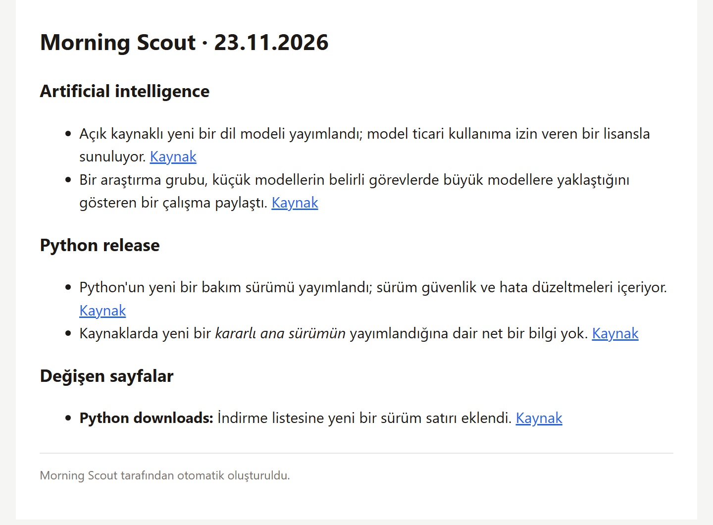
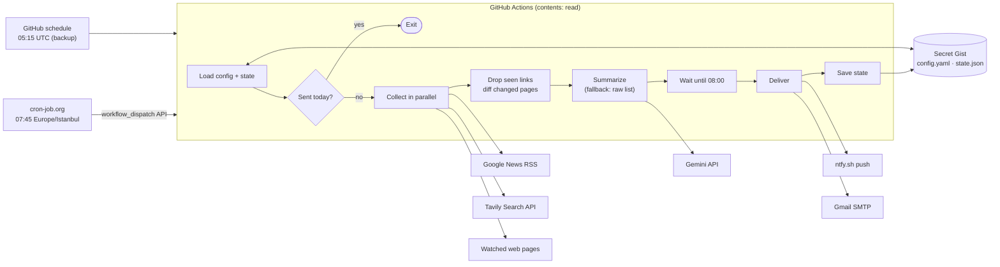

# Morning Scout

**A privacy-first research assistant that scans the news, the web and pages you watch every morning, and sends you only what's new as a short AI-written digest.**

[](https://github.com/mertucan/Morning-Scout/actions/workflows/ci.yml)


## Why I built this

> _TODO: 2–3 sentences about your motivation, e.g. the topics you kept checking by hand every morning and why you wanted a hands-off, private way to do it._

## Features

- **Three kinds of sources.** Google News (last 24 h), Tavily web search (last day or week), and page watching with an optional CSS selector.
- **Only new things.** Links are normalized (tracking parameters, `www`, trailing slashes and fragments are removed) and hashed. Anything sent in the last 30 days is skipped.
- **Readable page diffs.** A watched page is compared with its last snapshot, and only the changed lines go to the summary. A newly added page is recorded silently on its first day instead of triggering a false alarm.
- **Grounded AI summary.** Gemini groups the results by topic and writes 1–2 sentences per item, each with a source link. It is told to use only the sources it is given, and to say so plainly when a question such as "are applications open?" has no clear evidence. Google Search grounding is not used.
- **Graceful degradation.** A failing source is skipped. If Gemini fails, you get a plain title + link list. On a quiet day you get a short "nothing new" push.
- **Two channels.** A compact Markdown push on your phone (ntfy) and a full HTML e-mail with clickable links (Gmail).
- **Delivered on time, once.** The run is triggered at 07:45, waits until exactly 08:00 local time, and never sends twice on the same day, even when the backup schedule also fires.
- **Private by design.** Topics, links and summaries never touch the repository, the commit history, Actions logs or artifacts (see [Privacy design](#privacy-design)).
- **Free to run.** Every service is used within its free tier.

## Example output

| Push notification (ntfy) | E-mail digest |
| --- | --- |
|  |  |

_Screenshots coming soon (`docs/screenshots/`)._

## Architecture



### Project layout

```
morning_scout/
  __main__.py      CLI entry point (argparse)
  app.py           The pipeline: load → collect → dedupe → summarize → wait → deliver → save
  config.py        config.yaml parsing/validation and environment secrets
  storage.py       Secret Gist (GitHub REST API) or local folder
  state.py         Sent-link memory with 30-day expiry, compressed page snapshots
  urls.py          URL normalization and hashing
  sources/         news.py (Google News RSS), search.py (Tavily), pages.py (watch + diff)
  summarizer.py    Gemini prompt and no-AI fallback
  render.py        Short ntfy text and full HTML e-mail
  notify.py        ntfy and Gmail SMTP delivery
  timing.py        Time-zone aware "today" and waiting for the send time
  privacy.py       Log redaction and safe exception descriptions
  messages.py      All user-facing text and LLM instructions, per language
tests/             pytest suite; the network is blocked, all services are mocked
```

## Tech stack

| Concern | Choice |
| --- | --- |
| Language | Python 3.12, type hints, dataclasses |
| News | Google News RSS + `feedparser` |
| Web search | Tavily Search API (`basic` depth, max 5 results) |
| Page watching | `requests` + `BeautifulSoup`, `difflib` |
| Summarization | Google Gemini API via `google-genai` (default model `gemini-3.8-flash`) |
| Notifications | ntfy.sh (JSON publish, Markdown) and Gmail SMTP (HTML) |
| Storage | Secret GitHub Gist via REST API |
| Scheduling | GitHub Actions + cron-job.org |
| Quality | `pytest`, `ruff` (lint and format), CI on every push and PR |

## Setup

Everything below uses free tiers. Budget about 20 minutes.

### 1. Get the API keys

| Secret | Where |
| --- | --- |
| `GEMINI_API_KEY` | [Google AI Studio](https://aistudio.google.com/apikey) → *Create API key*. Check your project's free-tier limits at [aistudio.google.com/rate-limit](https://aistudio.google.com/rate-limit). Morning Scout makes one request per day. |
| `TAVILY_API_KEY` | [tavily.com](https://tavily.com) → sign up → API key. The free plan has 1,000 credits a month, and a basic search costs 1 credit, so keep `searches` under ~30 entries. |

### 2. Gmail (app password)

1. Turn on **2-Step Verification** for your Google account (app passwords require it).
2. Create an app password at [myaccount.google.com/apppasswords](https://myaccount.google.com/apppasswords).
3. Use your address as `GMAIL_ADDRESS` and the 16-character password as `GMAIL_APP_PASSWORD`. `MAIL_TO` is optional and defaults to the sender.

### 3. ntfy (push notifications)

1. Install the ntfy app ([Android](https://play.google.com/store/apps/details?id=io.heckel.ntfy) / [iOS](https://apps.apple.com/app/ntfy/id1625396347)).
2. Pick a **hard-to-guess topic name**. Anyone who knows a topic name on ntfy.sh can read it. For example, run `python -c "import secrets; print('scout-' + secrets.token_hex(12))"`.
3. Subscribe to that topic in the app and save the name as `NTFY_TOPIC`.

### 4. Secret Gist (your config and memory)

1. Go to [gist.github.com](https://gist.github.com) and create a **secret** gist with two files:
   - `config.yaml`: start from [`config.example.yaml`](config.example.yaml) and add your own topics.
   - `state.json`: contents `{}`.
2. The gist id is the last part of its URL (`gist.github.com/<user>/<GIST_ID>`). Save it as `GIST_ID`.
3. Create a token for `GIST_TOKEN`:
   - **Recommended: fine-grained personal access token** ([settings](https://github.com/settings/personal-access-tokens/new)). Under *Account permissions*, set **Gists** to *Read and write*. No repository access is needed. GitHub's [permissions reference](https://docs.github.com/en/rest/authentication/permissions-required-for-fine-grained-personal-access-tokens) lists `PATCH /gists/{gist_id}` under this permission. Set an expiry date and a reminder to rotate it.
   - **Alternative: classic personal access token** with **only the `gist` scope** ([settings](https://github.com/settings/tokens/new?scopes=gist)). Use it if the fine-grained token cannot read your secret gist (the run log will show `Storage: Gist GET failed: HTTP 404`).

> A *secret* gist is unlisted, not encrypted: anyone with its URL can open it. That is why `GIST_ID` is stored as a secret and never logged.

To edit your topics from your phone, open the gist in a mobile browser and edit `config.yaml`. If you break the YAML, the next run sends an ntfy alert with only the line number.

### 5. Repository secrets

In **Settings → Secrets and variables → Actions → New repository secret**, add:

`GEMINI_API_KEY`, `TAVILY_API_KEY`, `GMAIL_ADDRESS`, `GMAIL_APP_PASSWORD`, `MAIL_TO`, `NTFY_TOPIC`, `GIST_ID`, `GIST_TOKEN`

Test it: **Actions → Morning Scout → Run workflow**. The run sends right away if it's after 08:00, and waits until 08:00 otherwise (at most 25 minutes).

### 6. Reliable trigger with cron-job.org

GitHub's `schedule` trigger can run late, sometimes by an hour or more. The workflow is therefore started by an external cron service. The built-in schedule (05:15 UTC = 08:15 Istanbul) stays as a backup, and the daily guard makes sure you never get two digests.

1. Create a second **fine-grained token** that can do only one thing:
   *Repository access* → *Only select repositories* → this repository; *Repository permissions* → **Actions: Read and write**.
2. On [cron-job.org](https://cron-job.org), create a job:

   | Field | Value |
   | --- | --- |
   | URL | `https://api.github.com/repos/<owner>/<repo>/actions/workflows/morning-scout.yml/dispatches` |
   | Schedule | Every day, **07:45**, time zone **Europe/Istanbul** |
   | Method | `POST` |
   | Headers | `Authorization: Bearer <token>`<br>`Accept: application/vnd.github+json`<br>`X-GitHub-Api-Version: 2022-11-28` |
   | Body | `{"ref":"main"}` |

3. Use *Test run*. A `204 No Content` response means the workflow was queued.

### 7. Run locally

```bash
python -m venv .venv && source .venv/bin/activate   # Windows: .venv\Scripts\activate
pip install -r requirements-dev.txt
cp .env.example .env                                 # fill in the keys you want to test
mkdir data && cp config.example.yaml data/config.yaml

python -m morning_scout --local --dry-run            # print the digest, send nothing, save nothing
python -m morning_scout --local --now                # really send, without waiting for 08:00
pytest && ruff check . && ruff format --check .
```

| Flag | Effect |
| --- | --- |
| `--dry-run` | Print the digest to the terminal. Nothing is sent and state is not written. |
| `--now` | Send immediately instead of waiting for `send_time`. |
| `--force` | Run even if today's digest was already sent. |
| `--local` | Use `./data/` (or `$DATA_DIR`) instead of the Gist. Setting `DATA_DIR` alone does the same. |
| `--verbose` | Detailed, unredacted logs for debugging. |

`--dry-run` and `--verbose` both print personal data, so they are **refused when running on GitHub Actions**.

## Configuration

```yaml
news:                     # Google News queries (last 24 h)
  - artificial intelligence
searches:                 # Tavily web searches; questions work well
  - Has a new stable Python version been released?
pages:                    # pages to watch; css_selector is optional
  - name: Python downloads
    url: https://www.python.org/downloads/
    css_selector: ".download-list-widget"
gemini_model: gemini-3.8-flash
send_time: "08:00"
timezone: Europe/Istanbul
summary_language: tr      # "tr" or "en" (other codes get English UI text)
search_time_range: day    # "day" or "week"
```

## Privacy design

This repository is public, but what I follow is personal. The design keeps the code public and the data private.

- **Data lives outside the repo.** `config.yaml` (topics, watched URLs) and `state.json` (memory) live in a secret Gist that only the workflow's token can reach. The repo ships only [`config.example.yaml`](config.example.yaml), and `.gitignore` blocks `config.yaml`, `state.json`, `data/` and `.env`.
- **The memory holds no links or titles.** `state.json` stores 16-character SHA-256 prefixes of normalized URLs and headlines, plus zlib-compressed page snapshots. The URLs and headlines themselves are not stored.
- **Logs contain counts, never content.** The application logs only aggregates, for example:
  ```
  Config: 6 news queries, 4 searches, 3 pages
  news: 41 results, 7 new
  search: query #2 failed: HTTPError (HTTP 429)
  pages: 1/3 changed, 0 first snapshot(s)
  Gemini: summary created (1834 characters)
  ```
- **Exceptions are sanitized.** Error messages from HTTP libraries usually include the full URL and query, so failures are logged as `describe_error(exc)`: the exception type plus the HTTP status, never the message.
- **A second safety net.** A logging filter on every handler redacts URLs and every registered sensitive value (topics, page names, headlines, secrets, the Gist id). It also drops tracebacks. Third-party loggers are capped at WARNING, because `httpx` logs request URLs at INFO.
- **CI can't leak by accident.** `--verbose` and `--dry-run` refuse to run when `GITHUB_ACTIONS=true`. No artifacts are uploaded. The workflow has `permissions: contents: read`.
- **Broken config alerts by line number only.** If `config.yaml` has a YAML error, the ntfy alert and the log show only the line number, not the content.
- **It's tested.** [`tests/test_privacy.py`](tests/test_privacy.py) runs the whole pipeline with sentinel values (fake topics, URLs, titles, summaries and secrets) and fails if any of them appears in the logs.

## License

[MIT](LICENSE)

---

## Türkçe Kurulum Özeti

1. **Anahtarlar:** [Google AI Studio](https://aistudio.google.com/apikey)'dan `GEMINI_API_KEY`, [tavily.com](https://tavily.com)'dan `TAVILY_API_KEY` al.
2. **Gmail:** Google hesabında 2 adımlı doğrulamayı aç, [uygulama şifresi](https://myaccount.google.com/apppasswords) oluştur. Adresin `GMAIL_ADDRESS`, şifre `GMAIL_APP_PASSWORD` olacak. `MAIL_TO` isteğe bağlı.
3. **ntfy:** Telefona ntfy uygulamasını kur. Tahmin edilmesi zor bir topic adı seç (ör. `scout-` + rastgele karakterler), uygulamada abone ol ve adı `NTFY_TOPIC` olarak kaydet.
4. **Secret Gist:** [gist.github.com](https://gist.github.com)'da secret gist oluştur. İçine `config.yaml` (örnek dosyadan) ve içeriği `{}` olan `state.json` koy. URL'nin sonundaki kimlik `GIST_ID` olacak. `GIST_TOKEN` için fine-grained token oluştur (Account permissions → **Gists: Read and write**). Okuma hatası alırsan sadece `gist` scope'lu klasik token kullan.
5. **GitHub Secrets:** Settings → Secrets and variables → Actions'a 8 secret'ı ekle. Actions → Morning Scout → *Run workflow* ile dene.
6. **cron-job.org:** Sadece bu repoya erişen, **Actions: Read and write** izinli ayrı bir fine-grained token oluştur. Her gün **07:45 (Europe/Istanbul)** için `POST https://api.github.com/repos/<kullanıcı>/<repo>/actions/workflows/morning-scout.yml/dispatches` işi kur. Header'lar: `Authorization: Bearer <token>`, `Accept: application/vnd.github+json`. Body: `{"ref":"main"}`. Test'te `204` dönmeli.
7. **Konuları düzenlemek:** Telefondan gist'i açıp `config.yaml`'ı düzenlemen yeterli. YAML bozulursa ntfy'ye satır numarasıyla uyarı gelir.
